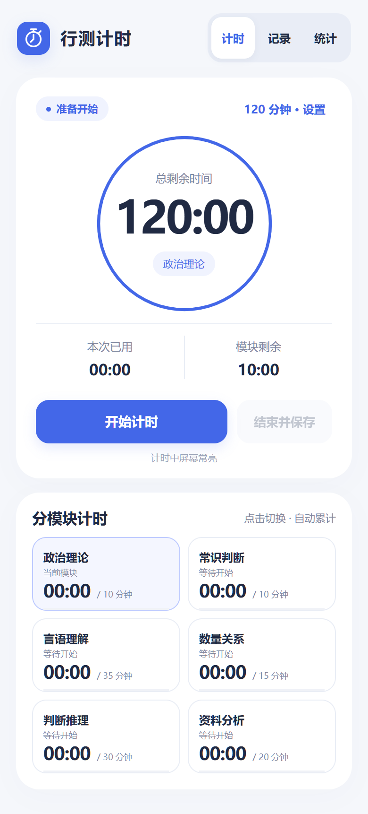
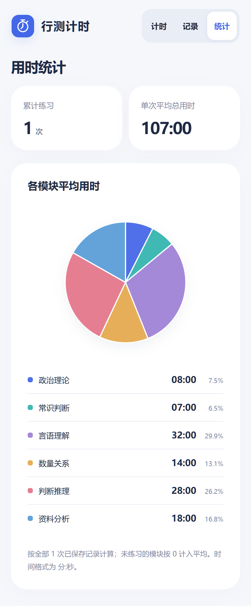

# 行测计时

一个简洁、离线的安卓行测计时 App，适配手机和平板。

[下载 APK](https://github.com/Arisf0617/xingce-timer/releases/latest) · [使用说明](docs/使用说明.md)

## 功能

- 自定义总倒计时，支持 90 / 120 分钟预设。
- 政治理论、常识判断、言语理解、数量关系、判断推理、资料分析六模块独立统计。
- 点击模块切换，切回后继续累计，显示当前模块剩余时间。
- 暂停、继续、到时提示与超时记录。
- 本地保存历史，按次查看用时扇形图，查看六模块平均用时扇形图。
- 计时运行且应用在前台时保持屏幕常亮。
- 无需账号、无广告、无联网权限。

## 界面

<table><tr><td></td><td></td></tr></table>

[平板界面](docs/screenshots/tablet.png)。截图为浏览器界面预览，统计图使用示例数据，安装包没有预置做题记录。

## 安装

支持 Android 8.0 及以上。从 Releases 下载 APK，在安卓设备上打开并按系统提示安装。

应用 ID 为 `cn.xingce.timer`。后续同签名安装包可覆盖安装，保留本地记录。卸载或清除应用数据会删除记录。

## 构建

依赖 JDK 17 / 21、Android SDK Platform 35 和 Build Tools 35。配置 `JAVA_HOME` 与 `ANDROID_HOME`，运行：

```powershell
.\gradlew.bat :app:assembleDebug :app:lintDebug
```

调试安装包输出到 `app/build/outputs/apk/debug/app-debug.apk`。首次构建需联网下载 Gradle 8.9 与 Android Gradle Plugin 8.7.3。

正式版的签名私钥和密码不包含在公开仓库。运行 `:app:assembleRelease` 可生成未签名 APK；如需使用自己的签名，复制 `signing.properties.example` 为 `signing.properties` 并填入本地密钥信息。自行签名的版本无法直接覆盖本仓库发布的正式版。

## 代码结构

- `TimerEngine.java`：基于单调时钟的模块累计、暂停与恢复逻辑。
- `MainActivity.java`：安卓宿主、本地存储、提示音、屏幕常亮和状态恢复。
- `app/src/main/assets/index.html`：自适应界面、历史列表和 SVG 扇形图。安卓安装版本使用原生存储；浏览器预览使用独立的浏览器本地存储。
- `tests/TimerEngineTest.java`：不依赖安卓运行环境的计时测试。

```powershell
New-Item -ItemType Directory -Force test-classes
javac -encoding UTF-8 -d test-classes app/src/main/java/cn/xingce/timer/TimerEngine.java tests/TimerEngineTest.java
java -cp test-classes TimerEngineTest
```

## 计时规则与验证

暂停时间不计入。平均用时以全部已保存记录为分母，某次未练习的模块按 0 计入。同次开机内恢复应用会继续累计；设备重启后，从最后检查点以暂停状态恢复，不补计关机时间。

已通过 Release 构建、Lint、APK 签名校验、计时引擎测试及 320–1280 像素宽度的界面自动化检查。尚未进行安卓真机或模拟器安装运行验证，屏幕常亮、提示音与厂商后台策略需要设备实测。
